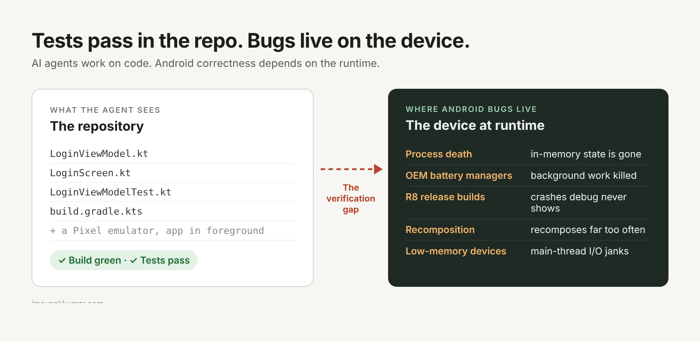

It's 2:07 AM, and Crashlytics has opinions. The crash is in a ViewModel that `git blame` says you wrote. You didn't. An agent did, and its pull request said "all tests pass." They do. The agent updated the expected values to match its new behaviour.

That's a composite, not a confession. But it points at a real shift in Android work. This post covers what AI tools can do on Android today, why "the tests pass" is not the same as "it works" on a phone, and what to get better at.

## What can AI tools do on Android today?

Quite a lot. Android Studio's [May 2026 release](https://android-developers.googleblog.com/2026/05/whats-new-android-developer-tools.html) includes an agent that plans multi-step work and fixes its own build errors, "Fix with AI" for crashes in App Quality Insights, and an option to hand LeakCanary traces to an agent. Google also runs [Android Bench](https://android-developers.googleblog.com/2026/03/elevating-ai-assisted-androi.html), which gives models real issues from public Android repos and checks each fix with tests. At its March 2026 launch, models solved between 16% and 72% of tasks.

So writing Android code is no longer the slow part. Checking it is.

## Why is "almost right" the expensive part?

Because it compiles, looks fine in review, and fails later. In Stack Overflow's [2025 survey](https://survey.stackoverflow.co/2025/ai), 66% of developers named "AI solutions that are almost right, but not quite" as their top frustration. Google's [DORA 2025 report](https://www.infoq.com/news/2025/09/dora-state-of-ai-in-dev-2025) found that AI adoption goes with higher delivery throughput, while delivery instability keeps rising.

When changes get cheap to produce, teams produce more of them. The limit becomes how much change you can verify.

## Why is this harder on Android?

Because an agent works on the repository, but Android correctness depends on the device at runtime.

Process death, OEM battery managers, R8 in release builds, unexpected recomposition, and main-thread work on low-memory devices rarely show up in a diff. Most don't show up on a flagship emulator either.

Android Bench counts a task as solved when the tests pass. That's fair for a benchmark and risky for a release. Tests only check what someone thought to check, and an agent working toward green will take the shortest path there. Sometimes that path goes through the test file.

## Doesn't AI debug too?

It does, and it's improving. At 2 AM, an agent can give you three possible explanations for a crash in seconds. The hard part is picking the true one: what the evidence supports, and whether the fix treats the cause or just hides it behind a `?.let`. That takes a mental model of the system.

Two things are less certain. Simple apps may end up mostly built by agents, so deep Android skill will matter most where failure is expensive. And if junior engineers stop writing the boring code, it's not clear how they'll build that mental model. I don't have an answer to that yet.

## What's coming next?

Your app may get a second kind of user. [AppFunctions](https://developer.android.com/ai/appfunctions), an experimental API on Android 16 and higher, lets an app expose functions that agents can call. The function's KDoc becomes the description the agent reads. That makes KDoc an interface contract, and it makes every argument LLM-generated input that you validate like any untrusted input.

## What should you do now?

Make checking cheaper than generating.

| Habit | What it catches | How to start |
| --- | --- | --- |
| Process-death test | State lost when the user returns | Background the app, run `adb shell am kill <package>`, reopen |
| Release-build smoke test | R8 removing code you still need | Run your critical flow on the minified build |
| One Macrobenchmark | Performance regressions | Measure startup or scrolling on your key screen |
| Small agent diffs | Changes nobody can review properly | Ask for a plan first; read any edited tests first |
| Read traces | Fixes for the wrong cause | Perfetto for jank, a heap dump for leaks |

And write some code by hand on purpose, in the parts you want to understand deeply. That's how mental models get built.

## So, who debugs at 2 AM?

You and an agent, together. The agent will produce explanations faster. Your job is knowing which one is true and owning the release.

What's the most convincing "almost right" code an AI tool has given you on Android?
